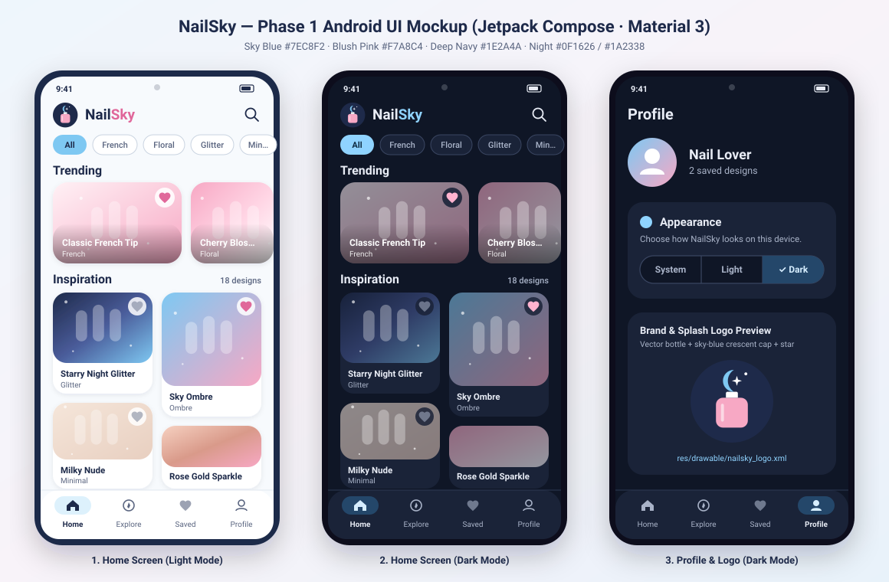

# NailSky 💅☁️

A nail art inspiration app for Android, built with Kotlin, Jetpack Compose, Material 3, Room, and Coil.

## Features

- **Home**: top bar with logo, wordmark, and quick search shortcut; category chips (`All`, `French`, `Floral`, `Glitter`, `Minimal`, `Ombre`, `Seasonal`); a "Trending" carousel; and an "Inspiration" staggered grid with animated cards
- **Design Detail Screen**: full hero photo, metadata pills (shape, finish, difficulty, estimated duration), interactive color palette swatches (tap to copy hex), clickable `#tags`, numbered how-to / salon steps, personal salon notes (persisted in Room), Android Share sheet, Add to Board sheet, and "More Like This" recommendations
- **Explore & Search**: live multi-keyword search across titles, tags, descriptions, and artists; expandable Shape & Finish filter tray; trending `#tags`; "Browse by Style" collection cards; and featured nail artists
- **Saved & Boards (Room Persistence)**: hearted designs and custom emoji boards persist locally across app restarts, with board filtering, creation, and deletion
- **Real Nail Art Photography + Offline Fallback**: remote nail photography loaded and cached with Coil (`crossfade`), layered over NailSky's signature gradient artwork so cards remain crisp while loading or offline
- **Profile**: editable display name (DataStore), Saved/Boards/Recent stats, Recently Viewed carousel with clear option, and Appearance setting (`System` / `Light` / `Dark`)
- **UI Polish**: spring-animated heart toggle with haptic feedback, smooth animated navigation transitions, and snackbar feedback

## UI Mockup



## Tech

| | |
|---|---|
| Language | Kotlin 2.0.21 + KSP |
| UI | Jetpack Compose (BOM 2024.12.01), Material 3, navigation-compose |
| Images | Coil 2.7.0 (`coil-compose`) with gradient fallback |
| Persistence | Room 2.6.1 (saved designs, boards, notes, history), DataStore Preferences (theme & profile name) |
| Build | AGP 8.7.3, Gradle 8.9 (wrapper), Kotlin DSL + version catalog, Java 17 |
| SDK | minSdk 24, target/compileSdk 35 |
| Other | core-splashscreen, JUnit 4 unit tests |

## Download APK from Actions → Artifacts

GitHub Actions runs unit tests and builds the APK on every push and pull request to `main`. You can also start a build by hand.

1. Open the repo on GitHub and go to the **Actions** tab.
2. Select the latest successful **Android CI** run. To start a new one, choose **Run workflow**.
3. Scroll to **Artifacts** and download **`nailsky-debug-apk`**.
4. Unzip the download and install `app-debug.apk` on your device. You'll need to allow installs from unknown sources.

## Local build (optional)

```bash
./gradlew testDebugUnitTest assembleDebug
```

The APK is written to `app/build/outputs/apk/debug/`.

## Project structure

```
app/src/main/java/com/nailsky/app/
  MainActivity.kt
  data/
    NailDesign.kt, SampleData.kt, DesignFilter.kt
    ThemePreferences.kt, NailSkyRepository.kt
    local/           NailSkyEntities, NailSkyDao, NailSkyDatabase (Room)
  ui/theme/          Color, Theme, Type
  ui/navigation/     NailSkyNavHost (bottom nav, routes & transitions)
  ui/components/     NailSkyTopBar, CategoryChips, DesignCard, BoardSheet
  ui/screens/        Home, Explore, Saved, Profile, DesignDetail
app/src/test/java/com/nailsky/app/
  data/              DesignFilterTest
```

The in-app logo (`res/drawable/nailsky_logo.xml`) is separate from the launcher icon (`ic_launcher_foreground.xml`), so you can replace either one later, for example with a PNG.
